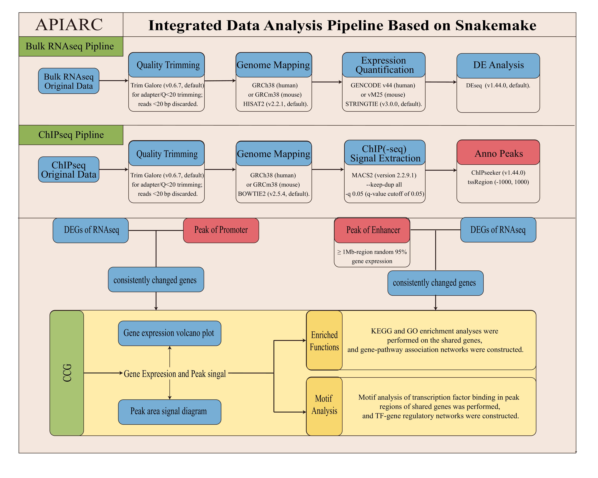

# APIARC



APIARC 是一个 bulk RNA-seq 与 ChIP-seq 的联合分析流程，用 Snakemake 描述，提供 Streamlit
界面入口。
RNA-seq 与 ChIP-seq 的差异结果取交集后，交集规模受阈值选择影响，不能作为转录水平与染色质
水平变化相关的证据。该流程将问题拆解为四项可分别检验的假设，逐项给出统计结果、判定依据与
结果文件。

界面默认英文，可在总览页切换为中文。

---

## 1. 生物学意义

基因表达程序的重编程以染色质状态改变为前提。增强子上的 H3K4me1 与 H3K27ac、启动子上的
H3K4me3 分别标记顺式调控元件的不同活化阶段，转录因子的结合位点进一步标出直接调控的位置；
这些修饰在刺激、分化或病理过程中的动态变化，记录了转录因子与调控元件重新组合的过程。

Bulk RNA-seq 给出转录输出的快照，ChIP-seq 给出染色质修饰的空间分布。单看任一份数据只能
得到差异基因或差异区域的清单；把两者放在同一坐标系下，才能回答染色质改变与转录变化之间
的对应关系：哪些修饰变化与表达变化同步，哪些先于转录发生，以及修饰的组合如何决定转录的
方向。

联合分析的价值在三个层面：

1. 染色质层面的重编程：各修饰在条件之间获得或丢失哪些区域，哪些变化在时间点或条件之间
   持续存在。
2. 增强子与启动子的分工：增强子标记与启动子标记的变化是否同步，据此区分增强子活化与启动子
   释放这两个调控步骤。
3. 上游调控因子的推断：差异区域富集的 motif 指向介导响应的转录因子及其协作因子。

流程将上述目标落成四个可分别检验的步骤：

| 步骤 | 检验内容 | 对象 | 输出 |
|---|---|---|---|
| 1 | 每个 mark 在每个对比中是否存在差异结合 | 各 mark、各处理组与对照 | `5_diffbind/` |
| 2 | 差异结合基因的表达变化是否为分布差异，以及增强子与基因的关联随距离的变化 | 差异区域关联的基因，与同一条件的 RNA-seq 比较 | `0_stats/`、`3_enhancer/` |
| 3 | 差异结合基因与差异表达基因的重叠是否高于随机 | 同上 | `0_stats/` |
| 4 | 差异区域的 motif 是否不同于同 mark 的不变区域 | 各对比的差异区域，背景为同 mark 的静态峰 | `2_motif/` |

## 2. 运行方式

### 2.1 首次启动

```bash
git clone https://github.com/nculiujy/APIARC.git && cd APIARC

./bootstrap.sh --full      # 启动器 + CLI + 分析环境 + 阶段环境，首次约 7 GB
apiarc-app                 # 打开界面，默认 http://127.0.0.1:8501
```

`bootstrap.sh` 建立两套环境：启动器 `.apiarc-runtime/`（运行界面所需）与分析环境
`analysis-env/`（snakemake、sra-tools、hisat2、bowtie2、samtools 等）。加 `--full` 时同时
创建 `workflow/envs` 下各阶段环境；省略时只装启动器与命令，分析环境留待
`apiarc-app-update analysis` 补建。

### 2.2 命令行工具

| 命令 | 作用 |
|---|---|
| `apiarc-app` | 启动界面；端口被占用时自动加一 |
| `apiarc-app --private` | 仅绑定 127.0.0.1 |
| `apiarc-app-status` | 启动器、分析环境与进程状态 |
| `apiarc-app-logs -f` | 跟随服务端日志 |
| `apiarc-app-shell` | 打开带分析工具的交互 shell |
| `apiarc-app-update` | 检查并补齐软件环境：已装好的跳过，只建缺失的启动器、分析环境与新增的阶段环境 |
| `apiarc-app-update launcher` | 只补建启动器 |
| `apiarc-app-update analysis` | 只补建分析环境与阶段环境 |
| `apiarc-app-stop` | 停止界面服务 |
| `apiarc-app-uninstall` | 卸载启动器与分析环境，保留 `workflow/data`、`result`、`logs` |

`apiarc-app-update` 不会重复安装：启动器与分析环境已就绪时直接返回，阶段环境按
`workflow/envs/*.yaml` 逐个检查，已有的标为 present 跳过。因此平时执行只需几秒，只有新增阶段
或换了机器时才真正下载。升级软件版本后需要先删除对应目录（`.apiarc-runtime/launch`、
`analysis-env/` 或 `analysis-env/envs/<阶段>`），再执行才会按新版定义重建。

配置文件位于 `config/config.yaml`，界面与命令行读取同一份，修改后在页面上的下一次操作即生效。

### 2.3 界面

| 页面 | 作用 |
|---|---|
| 总览 | 当前数据集、环境状态、三端阶段进度、阻塞项、最近运行、语言切换 |
| 环境检测 | 检查启动器与分析环境的依赖是否完整，只读 |
| 注释构建 | 按组装构建 RNA-seq 与 ChIP-seq 比对索引，显示阶段与进度；JASPAR motif 数据库在此下载 |
| 组学准备 | 从 GEO 或本地目录选样本，编辑样本表与比较方向，下载原始数据 |
| 组学运行 | 选择运行范围与并行核数，启动或停止；日志按组学与运行次数分抽屉 |
| 联合分析 | 前置条件检查、统计与富集参数、运行、验收检查 |
| 结果查看 | 差异表达表与火山/MA 图、peak 与注释、联合分析图表、多轨信号浏览 |

## 3. 界面操作建议

### 3.1 一次性准备

1. 打开「总览」确认环境状态没有缺失项；有缺失时到「环境检测」按提示处理。
2. 在「注释构建」选定基因组版本，分别构建 RNA-seq 与 ChIP-seq 的比对索引；两个索引各占一个
   任务槽，可以同时构建；完成后点「应用并同步两个组学」。
3. 同一页面的「motif 注释数据库」下载 JASPAR 矩阵。换组装时再做一次。

### 3.2 每个数据集的操作顺序

```
组学准备 · 第 1 步：选样本（GEO 新建或已有目录）→ 保存所选 → 下载原始数据
    ↓
组学准备 · 第 2 步：填样本表 → 设比较方向 → 保存（写 metadata.csv 与 comparisons.csv）
    ↓
组学运行：选运行范围与并行核数 → 启动（RNA-seq 与 ChIP-seq 各占一个任务槽，可同时跑）
    ├─ RNA-seq：1_rawdata → 2_cleandata → 3_align_quant → 4_deseq
    └─ ChIP-seq：1_rawdata → 2_cleandata → 3_align → 4_peaks → 5_diffbind
    ↓
联合分析：前置条件检查 → 运行 → 验收检查
    ↓
结果查看：选数据集 · 注释版本 → 0_stats → 5_diffbind / 4_deseq
          → 1_enrichment / 2_motif
```

节点要点：

1. **第 1 步**：下载范围是勾选的 run，与第 2 步的表格无关，表格可以之后再改。
2. **第 2 步**：ChIP-seq 一行一个测序文库，`role` 选 `IP` 或 `Input`，Input 是不加抗体的
   对照，同样下载与比对，但不参与差异比较；IP 行在 `input_sample` 下拉里选择对应 Input；
   组名建议写成 `<mark>_<处理>`（如 `H3K27ac_veh`），下游按最后一个下划线识别 mark。
   RNA-seq 的 `sample` 不可编辑，`group` 取 `control` 或 `treatA`–`treatD`，`control` 是
   参照组，每组至少 2 例。
3. **比较方向**：填 reference 与 treatment（如 `H3K27ac_veh` 对 `H3K27ac_dox`）；保存前会
   检查半空行、自比与不足 2 例的组，不填则只做描述性分析。
4. **组学运行**：启动前回「总览」确认没有阻塞项；范围选「全部」时只跑到实际编译进来的最深
   阶段，不适用的阶段会标出不适用。
5. **联合分析**：前置条件检查不通过时先按提示补齐；参数可用默认值，运行结束后点验收检查，
   未通过的项目写在报告里。
6. **结果查看**：这里的注释版本只影响本页显示，不改配置。

### 3.3 几点建议

- 先用一组对照加一组处理、每组 2 例的小样本跑通，再换成全量数据。
- 并行核数不超过机器的物理核数；比对与 peak calling 阶段内存占用比较高，核数开太多反而更慢。
- 关闭浏览器不影响后台任务。重新打开页面后，在「组学运行」底部按运行次数查看日志。
- 首次运行某个阶段时会现场创建该阶段的软件环境，比后续运行慢。
- 更换注释版本后所有阶段会重新运行，结果写入新的 `<组装>-<来源>` 目录，旧结果保留在原处。
- 换机器后先执行 `apiarc-app-update`，把缺失的环境建出来，再打开界面。

## 4. 结果

结果按组学、数据集与基因组版本分层存放，换版本时旧结果保留在原目录：

```
result/
├── RNAseq/<数据集>/<注释版本>/
│   ├── 1_rawdata/         清点与校验后的原始读段
│   ├── 2_cleandata/       去接头与低质量过滤后的读段
│   ├── 3_align_quant/     HISAT2 比对与 StringTie 定量
│   └── 4_deseq/           差异表达表、火山图、MA 图、PCA 与样本距离图
├── ChIPseq/<数据集>/<注释版本>/
│   ├── 1_rawdata/         清点与校验后的原始读段
│   ├── 2_cleandata/       过滤后的读段
│   ├── 3_align/           bowtie2 比对
│   ├── 4_peaks/           MACS2 peak、ChIPseeker 注释、bigWig 信号与热图
│   └── 5_diffbind/        共识峰、计数矩阵、presence/absence、q 值漂移、判据一致性
├── Integrated/<rna>__<chip>/<注释版本>/
│   ├── 0_stats/           分布检验、效应量、置信区间、重叠显著性
│   ├── 1_enrichment/      GO 与 KEGG 富集
│   ├── 2_motif/           AME motif 富集与 TF–基因调控网络
│   ├── 3_enhancer/        增强子与基因关联、距离分箱
│   └── 4_common/          共有基因表与表达–信号联合图
└── provenance/            校验记录、数据清单、验收报告
```

`<注释版本>` 形如 `GRCm38-gencode`。日志写入项目根目录的 `logs/`，按组学与阶段分开。

## 5. 框架

```
APIARC/
├── Snakefile                配置合并、阶段 include 条件、rule all
├── workflow/
│   ├── rules/               各阶段的输入输出与脚本调用
│   ├── scripts/             实际执行的程序（R / Python / Perl）
│   ├── envs/                各阶段的软件版本
│   └── resources/           参考基因组与注释，由界面下载或构建，不入版本库
├── config/config.yaml       基因组版本、当前数据集、peak 判定参数、联合分析参数
├── streamlit_app/           界面：views/ 七个页面，utils/ 数据与展示层，i18n/ 中英文资源
├── cli/ scripts/ runtime/   启动器、安装与环境构建
└── tests/                   内部测试
```

测序数据在 `workflow/data/<组学>/<数据集>/`，结果在 `result/`，日志在 `logs/`，运行环境在
`.apiarc-runtime/` 与 `analysis-env/`。

## 6. 参考基因组

支持 GRCm38（mm10）、GRCh38（hg38）、GRCh37（hg19）三套组装。

在「注释构建」页选定版本后，分别构建 RNA-seq 与 ChIP-seq 的比对索引，页面显示当前阶段与
进度。基因组与注释文件体积较大，不随代码发布；构建产物写入 `workflow/resources/`。
JASPAR motif 数据库在同一页面下载。
